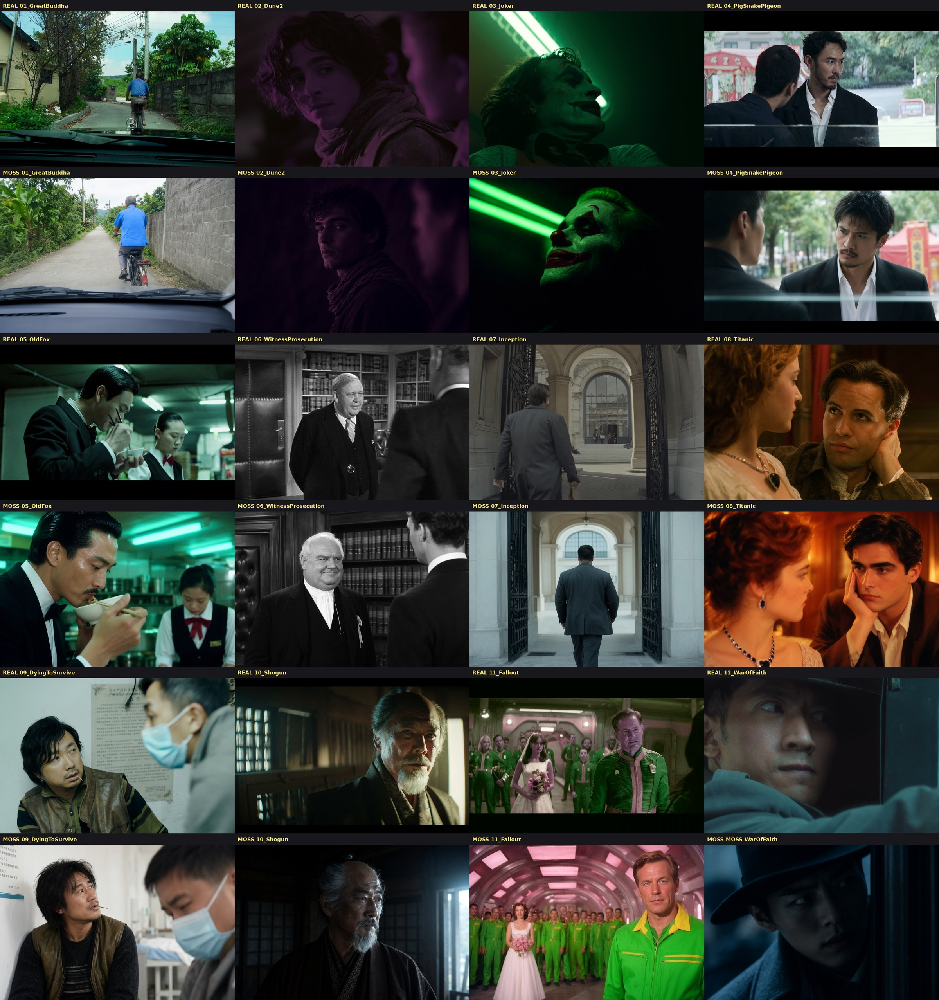
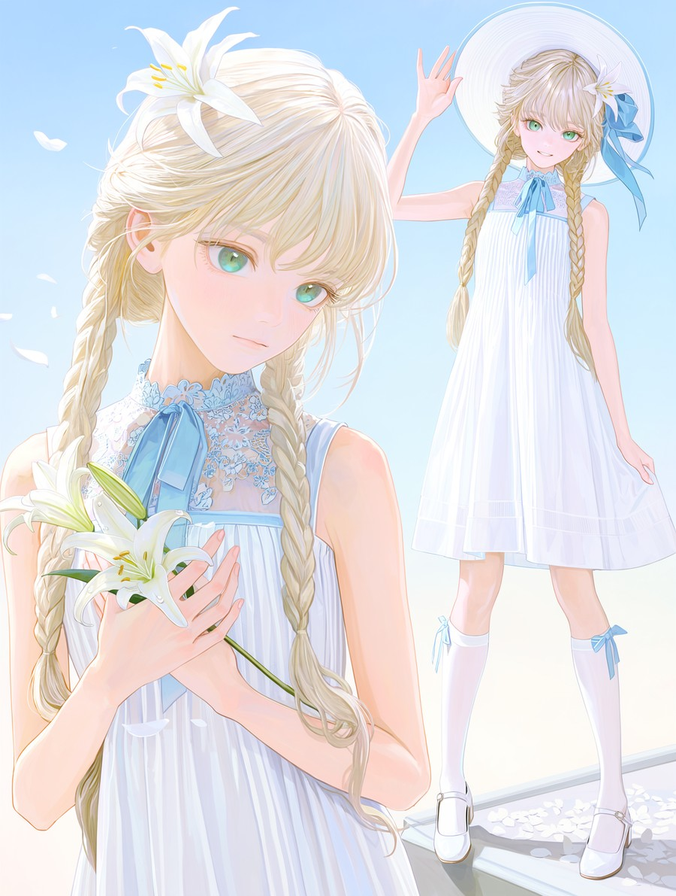
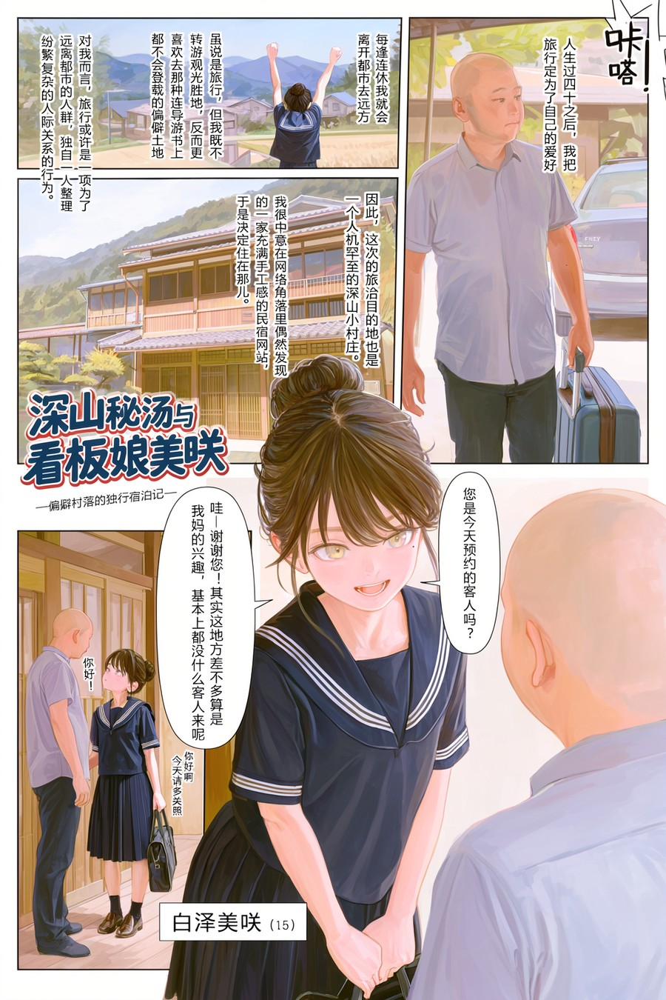
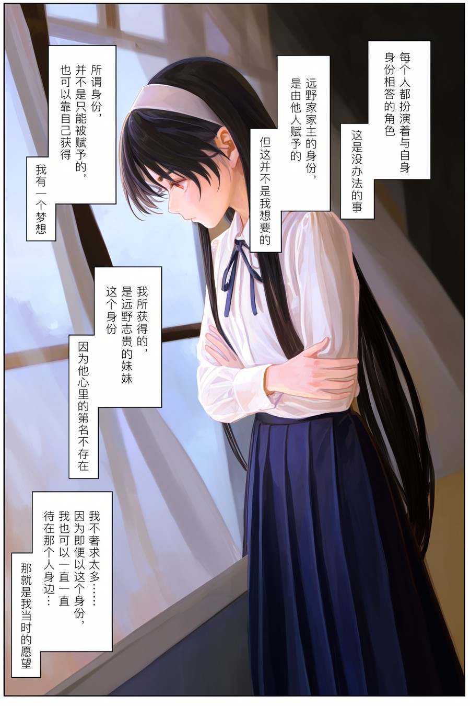
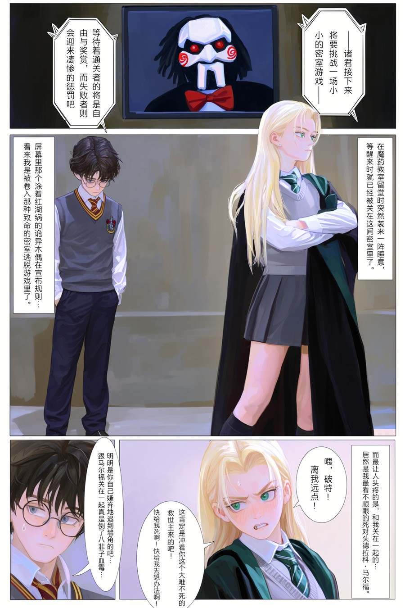
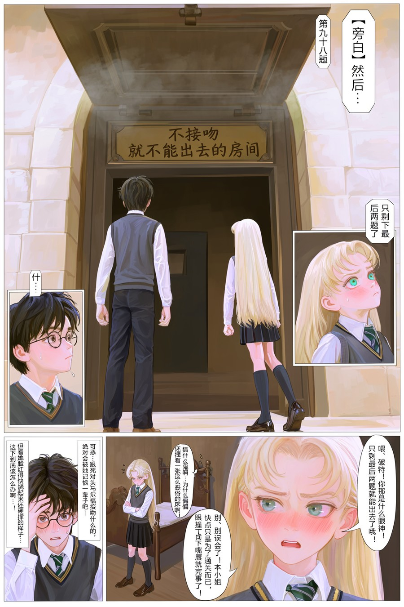
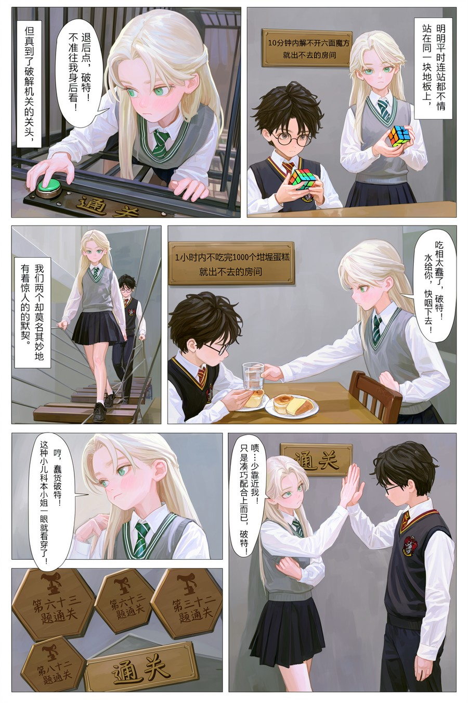

# moss-image-prompt-skill

给 `MOSS-Image`（OpenMOSS，Qwen3.5-9B 文本编码器 + 5B 单流 DiT）编写图像提示词的规则集：写实、二次元、跨次元三种模式，含多分镜漫画与 JSON 版式。

[](https://creativecommons.org/licenses/by-nc-nd/4.0/deed.zh-hans) [](https://creativecommons.org/licenses/by-nc-nd/4.0/deed.zh-hans) [](https://creativecommons.org/licenses/by-nc-nd/4.0/deed.zh-hans) [](https://creativecommons.org/licenses/by-nc-nd/4.0/deed.zh-hans) [](https://civitai.com/models/3013321/fkey-style-or-painterly-anime-lora-for-moss-image)

## 📌 更新记录

| 版本 | 日期 | 说明 |
| :---: | :---: | :--- |
| **v2.0.0** | 2026-10-21 | **人工重写**：全篇按实际出图流程重排序次，统一证据等级与术语；扩写二次元画风通道、四段式厚涂骨架、全彩多分镜 Layout 与气泡说话人归属；补齐默认参数与自检清单。 |
| v1.0.1 | 2026-10-18 | 收紧写实基底与负面池首排，修正 §0 模式启停描述。 |
| v1.0.0 | 2026-10-18 | 首次开源，单文件 Skill 格式。 |

## 🎬 影视剧照复刻

<a href="examples/replica-grid-12-films.jpg"></a>

**上行 `REAL` 是原作截图，下行 `MOSS` 是按本 `SKILL.md` 复刻出来的结果。** 12 组对照覆盖 90 年代港片、Dune、Joker、Inception、Titanic 等不同年代与调色风格。

复刻时**不写片名、不写演员名**，只按 §3.2 的写法组织描述：开头放光学与显影参数（胶片型号、镜头、色片），正文写机位与遮挡、灯具形态与面部受光位置、年代色调与颗粒，再加入打破精致感的日常小道具。同一套规则换掉开头的风格词组，就能在硬直闪、伦勃朗切割、霓虹抽帧、青橙宽银幕之间切换。

## 🎨 示例

以下全部由 `MOSS-Image-SFT` + [`FKEY Style` LoRA](https://civitai.com/models/3013321/fkey-style-or-painterly-anime-lora-for-moss-image) 生成，提示词按本仓库 `SKILL.md` 编写（采样：`euler` + `sgm_uniform`，Steps `50`，CFG `3.0`，Shift `5.0`，LoRA `0.6`）。

<table>
<tr>
<td width="50%"><a href="examples/01-portrait-lily.jpg"></a><br><sub><b>双人同框 · 发色与骨相隔离</b><br>金发与浅发两个角色，白裙双层蕾丝，高调过曝胶片</sub></td>
<td width="50%"><a href="examples/02-page-onsen-story.jpg"></a><br><sub><b>四格叙事页 · 竖排旁白 + 名牌框</b><br>「深山秘汤与看板娘美味」，旁白用直角方框、对白用带尾气泡</sub></td>
</tr>
<tr>
<td width="50%"><a href="examples/03-page-monologue.jpg"></a><br><sub><b>内心独白页 · 无尾气泡</b><br>画面外第一人称心声，靠窗逆光，旁白区不抢人物视线</sub></td>
<td width="50%"><a href="examples/04-page-escape-room-start.jpg"></a><br><sub><b>主画面 + 局部 inset</b><br>全头身格用 <code>character</code>、道具特写用 <code>object</code>，避免多长出人头</sub></td>
</tr>
<tr>
<td width="50%"><a href="examples/05-page-kiss-room.jpg"></a><br><sub><b>对称双人站位 + 表情特写</b><br>两个独立 BBox 拉开距离，inset 只放眼睛与脸颊</sub></td>
<td width="50%"><a href="examples/06-page-montage.jpg"></a><br><sub><b>六格蒙太奇 · 图内中文</b><br>「通关」木牌与印章，小格统一用腰上中景避免画成 Q 版</sub></td>
</tr>
</table>

## 🔗 配套 LoRA

本规则集的主要示例来自配套的 **[FKEY Style — Painterly Anime LoRA for MOSS-Image](https://civitai.com/models/3013321/fkey-style-or-painterly-anime-lora-for-moss-image)**：

> 一个 rank 4、18.66 MB、用 Muon 优化器训练的极轻量画风适配器：五官与发丝精致收笔，衣物与背景保留松弛的水粉笔触；低饱和蜜桃肤色，干净线条，不把每次生成锁死在同一角色或同一套服装上。

触发词放在正面提示词第一行，紧贴、不加空格、不加句号：

```text
<|artist|>fkey<|/artist|>
```

推荐强度 `0.4 – 0.8`（从 `0.6` 起）。想换成别的画师风格，按 `SKILL.md` §17.2 的四段式骨架替换触发词即可。

## 📜 授权条款（用之前请先读这一节）

本仓库全部文件（`SKILL.md`、`README.md`、`CHANGELOG.md`、`examples/`）依 **CC BY-NC-ND 4.0**
——**知识共享 署名-非商业性使用-禁止演绎 4.0 国际版**——提供。
中文官方摘要：<https://creativecommons.org/licenses/by-nc-nd/4.0/deed.zh-hans>；法律全文：[`LICENSE`](LICENSE)。

| ✅ 你可以 | ❌ 你不可以 |
| :--- | :--- |
| 复制、原样转发、下载自用（含把规则接进自己的出图工作流跑图） | 用于商业目的：售卖、塞进付费产品、商用外包交付、广告物料产出 |
| 引用其中一两条规则，并署名出处 | 改写 / 翻译 / 精简 / 换题材后当作新版本发布（ND = 禁止演绎） |
| 提 Issue 反馈问题、请求改写许可 | 去掉署名与协议声明，或声称这是官方出品 |

**一句话**：拿去用没问题；别改着发，别拿去卖。
想改着用（本项目专用、换语言、精简条款）？开个 Issue 说一声，书面许可基本都批。

## 内容

| 文件 | 说明 |
| :--- | :--- |
| `SKILL.md` | 规则本体：§0 任务定义与默认参数 → §1–§2 词条清洗与命名 → §3–§4 光影与构图 → §5–§6 年龄骨相与表情肢体 → §7–§9 多人、图内文字、游戏 HUD → §10 模板与自检 → §11–§14 禁用清单与官方规范 → §15 二次元画风 → §16 闭合标签 → §17 主次分级 → §18 多分镜漫画 → §19 气泡归属 |
| `examples/` | 6 张按本规则产出的示例图（见上） |
| `LICENSE` | CC BY-NC-ND 4.0 法律全文 |
| `CHANGELOG.md` | 版本记录 |

## 用法

放进 Agent Skills 目录（目录名需等于 frontmatter 里的 `name`）：

```
<skills-dir>/moss-image-prompt-skill/SKILL.md
```

或直接把它贴进系统提示词末尾。产出固定两件：一对 Positive / Negative Prompt，外加 §0 的采样参数说明。

## 三种次元模式

- **默认｜三次元真人写实**：漫符转译、结尾锁真句、写实毛孔基底与负面封杀组全部生效。
- **二次元**：主体描述保持画风中立（不写毛孔 / 闪光灯 / 胶片词），并停用上述三处写实条款。
- **跨次元 2D/3D 混合**：不套用任何单次元基底。

## 证据分级

`SKILL.md` §0 定义四档：**A** 受控对照证实（有 A/B 出图对照且经人工复核）/ **B** 单次观察复现 / **C** 机理假说（仅供推理，不得当规则执行）/ **D** 禁用（实测无效，清单见 §11）。

## 出处与授权

规则来自 OpenMOSS 官方 User Guide 与技术报告，以及本地 A/B 出图实测。

Copyright © 2026 Moeblack. 授权条款见文首「📜 授权条款」一节；法律全文见 [`LICENSE`](LICENSE)，中文官方摘要见 <https://creativecommons.org/licenses/by-nc-nd/4.0/deed.zh-hans>。
